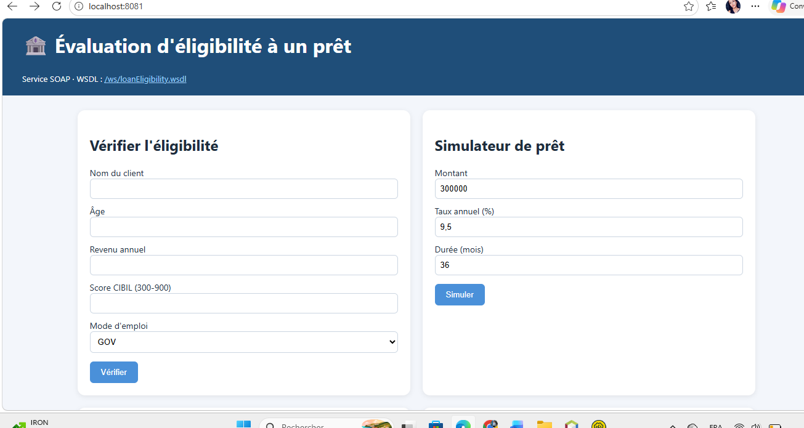
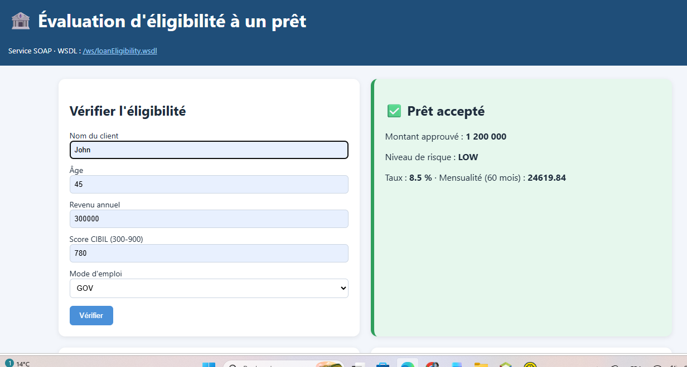
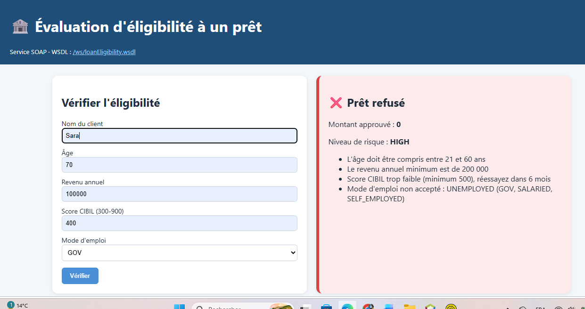
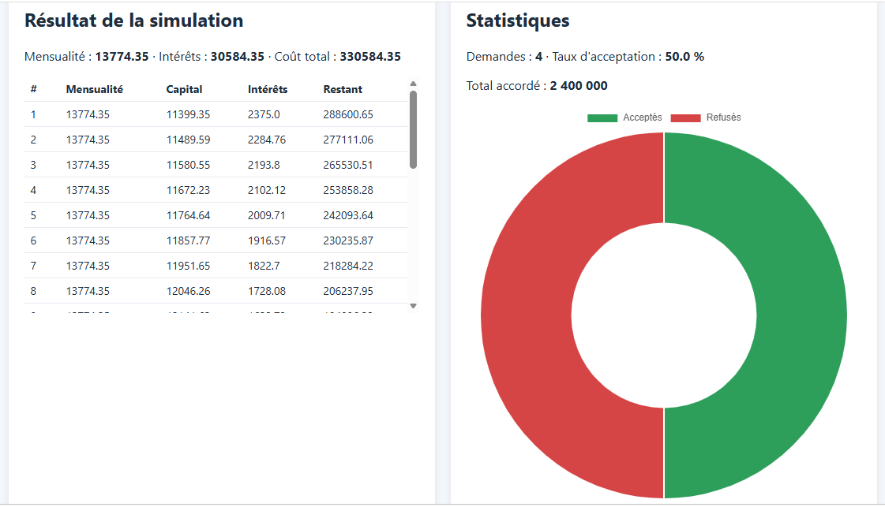
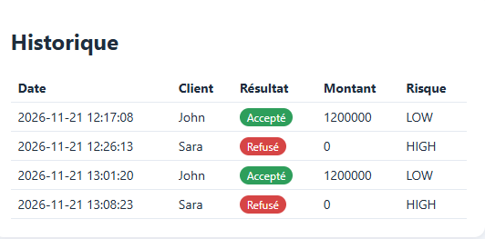

\# Loan Eligibility SOAP Web Service


\## Project Description


This project is a loan eligibility management system developed using \*\*Spring Boot\*\* and \*\*SOAP Web Services\*\*.


It allows users to evaluate loan applications, simulate loan repayments, consult application history and view statistics through a web interface.


\## Features


\- \*\*Loan Eligibility:\*\* Evaluate customer eligibility based on age, annual income, CIBIL score and employment status.

\- \*\*Risk Assessment:\*\* Determine the customer's risk level.

\- \*\*Loan Simulation:\*\* Calculate monthly payments, total interest and generate an amortization schedule.

\- \*\*Application History:\*\* Retrieve previous loan applications.

\- \*\*Statistics Dashboard:\*\* Display approved and rejected applications with graphical statistics.

\- \*\*Web Interface:\*\* Interactive interface developed with Thymeleaf.

\- \*\*SOAP API:\*\* Expose services through a WSDL contract.

\- \*\*Unit Testing:\*\* Validate business logic using JUnit 5.


\## Technologies Used


\- Java

\- Spring Boot 3.5.7

\- Spring Web Services (SOAP)

\- Maven

\- Thymeleaf

\- HTML / CSS / JavaScript

\- Chart.js

\- JUnit 5

\- SoapUI


\## SOAP Operations


\- Customer

\- LoanSimulation

\- LoanHistory

\- LoanStats


\## Testing


Run unit tests using:


```bash

mvn test

```


## Application Screenshots

### Image 1


### Image 2


### Image 3


### Image 4


### Image 5
